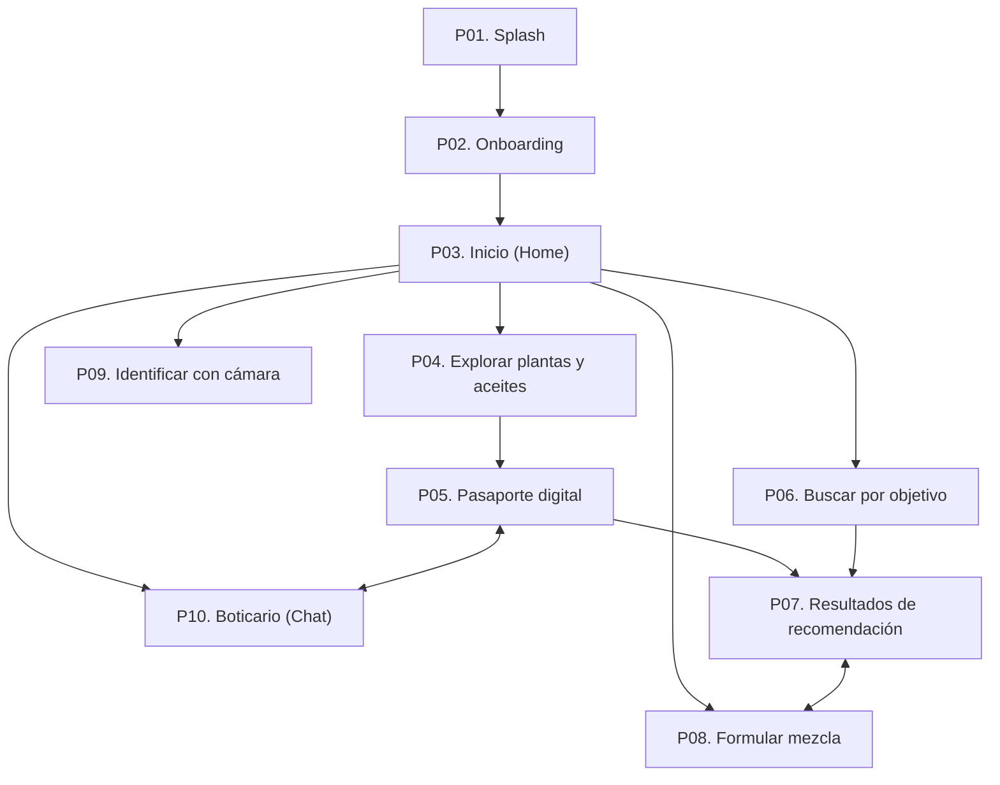

#5. Navegación de los mockups (versión simplificada)

Transcripción del panel "Flujo de navegación principal" de la lámina
[`../mockups.png`](../mockups.png). El catálogo descriptivo está en
[`pantallas.md`](pantallas.md) y el índice en [`README.md`](README.md).

Las capturas de la lámina están unidas por flechas de montaje que siguen la
numeración (1 a 10). Esas flechas no se leen aquí como flujo. El flujo descrito
es el del panel.

## Pantallas del panel

- [P01. Splash](pantallas.md#p01-splash)
- [P02. Onboarding](pantallas.md#p02-onboarding)
- [P03. Inicio (Home)](pantallas.md#p03-inicio-home)
- [P04. Explorar plantas y aceites](pantallas.md#p04-explorar-plantas-y-aceites)
- [P05. Pasaporte digital](pantallas.md#p05-pasaporte-digital)
- [P06. Buscar por objetivo](pantallas.md#p06-buscar-por-objetivo)
- [P07. Resultados de recomendación](pantallas.md#p07-resultados-de-recomendación)
- [P08. Formular mezcla](pantallas.md#p08-formular-mezcla)
- [P09. Identificar con cámara](pantallas.md#p09-identificar-con-cámara)
- [P10. Boticario (Chat)](pantallas.md#p10-boticario-chat)

En el panel, la fila bajo "3. Inicio (Home)" se ordena de izquierda a derecha
así: 4, 6, 9, 8, 10. En la fila inferior quedan 5 y 7.

## Conexiones dibujadas en el panel

Flechas explícitas:

1. P01 -> P02
2. P02 -> P03
3. P03 -> P04
4. P03 -> P06
5. P03 -> P09
6. P03 -> P08
7. P03 -> P10
8. P04 -> P05
9. P05 -> P07
10. P06 -> P07
11. P07 <-> P08: trazo acodado con flecha en ambos extremos.
12. P05 <-> P10: tramo inferior con flecha en ambos extremos.

No hay conexión dibujada desde P09 hacia P05.

## Diagrama

La disposición automática de Mermaid no reproduce la posición exacta de los
nodos en el panel. El diagrama representa las conexiones, no el trazado.

## Transiciones sugeridas por controles, no observadas en el panel

- P09 "Ver pasaporte" sugiere P09 -> P05 por el nombre. Es una inferencia a
  partir del texto del botón, no una flecha del panel, y queda excluida del
  grafo observado.
- P05 "Ver formulaciones relacionadas" no tiene mapeo explícito a una pantalla.
  El panel enlaza P05 con P07 y P10, no directamente con P08.
- P07 "Ver más detalles" y P08 "Guardar formulación" no están asociados por el
  panel a un destino ni a un control inequívoco.

## Principios textuales de la lámina

- En el panel: "Navegación simple, con accesos rápidos y sin menús profundos".
- Banda inferior:
  - "Acceso directo a lo esencial": "Cinco funcionalidades principales desde el
    inicio.".
  - "Poca profundidad": "Máximo 2 niveles por funcionalidad.".
  - "Experiencia móvil": "Diseñada para ser intuitiva y fácil de usar.".

El panel dibuja cinco flechas desde "3. Inicio (Home)" hacia P04, P06, P09, P08
y P10, en línea con las cinco funcionalidades principales desde el inicio.

## Barra inferior compartida

- Visible en las capturas 3 a 10: "Inicio", "Favoritos", "Historial" y "Perfil".
- "Inicio" aparece resaltado en las capturas 3 a 10.
- La lámina no incluye capturas propias de "Favoritos", "Historial" ni "Perfil",
  y el panel no dibuja su flujo.

## Cuestiones por aclarar

- Qué controles o acciones materializan los vínculos con punta en ambos
  extremos (P07 <-> P08 y P05 <-> P10) y si implican volver o abrir otra ficha.
- Cómo se llega desde P09 al pasaporte, dado el botón "Ver pasaporte" visible en
  la captura: el panel no dibuja esa conexión.
- Qué control de cada pantalla dispara cada conexión del panel.
- Los flujos de la barra Inicio/Favoritos/Historial/Perfil no están
  representados en el panel.

## Notas de lectura

- Las flechas de montaje entre las diez capturas siguen la numeración de las
  láminas y no se leen como flujo obligatorio.
- Este documento no propone destinos adicionales ni un backlog de producto.
